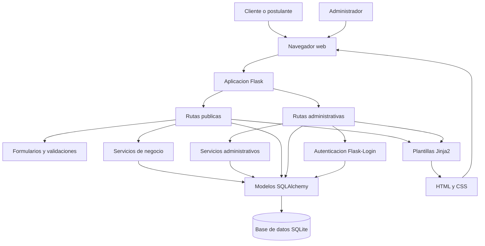
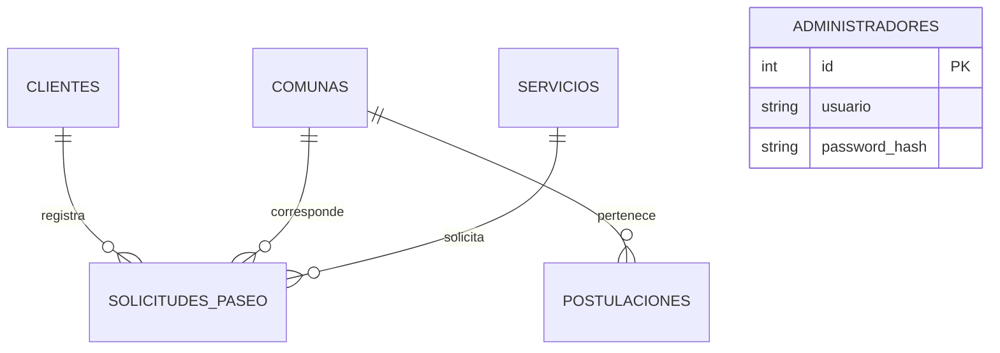
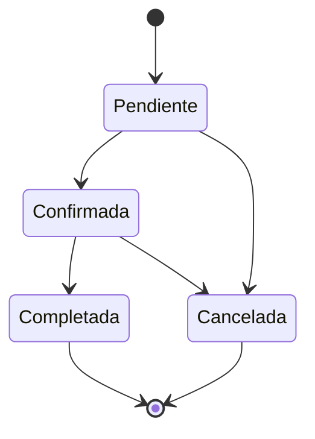
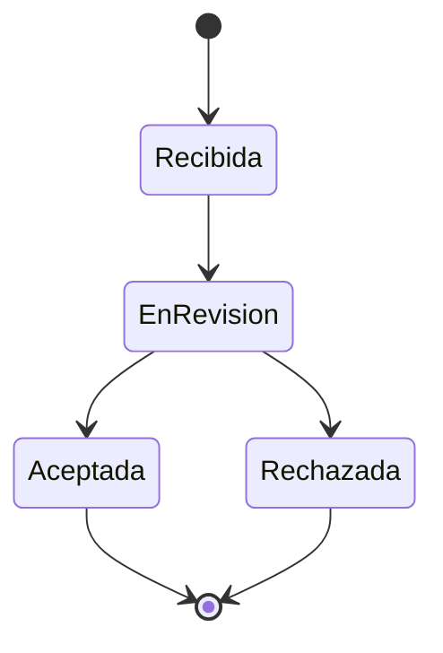

<div align="center">


# TEPASEO.CL

### Grandes paseos, pequeñas aventuras.

Plataforma web de gestión de servicios de paseo canino.


**Proyecto Integrador ACI 2026**

Universidad Diego Portales

</div>

---

## 1. Información académica

| Información | Detalle |
|---|---|
| Proyecto | Tepaseo.cl |
| Universidad | Universidad Diego Portales |
| Carrera | Ingeniería en Informática y Gestión |
| Jornada | Vespertina |
| Asignatura | Ingeniería de Software |
| Código | IIG03222 |
| Estudiante | Javier Ignacio Sepulveda Turen |
| Grupo | 3 |
| Modalidad | Individual |
| Periodo | Segundo semestre 2026 |

## 2. Descripción del proyecto

Tepaseo.cl es una plataforma web orientada a la gestión
de servicios de paseo para perros en Santiago de Chile.

El sistema permite consultar servicios y precios, verificar
la cobertura por comuna, registrar solicitudes de paseo
y recibir postulaciones de personas interesadas en
integrarse al equipo de paseadores.

La plataforma incorpora un panel administrativo privado
que permite revisar los registros, consultar indicadores
y gestionar los estados de las operaciones.

Tepaseo.cl se plantea como una empresa prestadora directa
de servicios, no como un marketplace de intermediación
entre clientes y paseadores independientes.

## 3. Problemática

Los propietarios de mascotas pueden enfrentar dificultades
para encontrar servicios de paseo organizados, confiables
y adaptados a sus necesidades.

Por otra parte, la gestión manual de solicitudes y
postulaciones puede generar desorganización, duplicidad
de información y dificultades de seguimiento.

Tepaseo.cl centraliza estos procesos en una plataforma
web que facilita la gestión de información y operaciones.

## 4. Objetivo general

Desarrollar una aplicación web que permita centralizar
las solicitudes de servicios de paseo canino y las
postulaciones de futuros paseadores, proporcionando
herramientas administrativas para su gestión.

## 5. Funcionalidades

### Portal público

- Página de inicio con identidad visual propia.
- Catálogo dinámico de servicios y precios.
- Consulta de cobertura por comuna.
- Formulario de solicitud de paseo.
- Formulario de postulación de paseadores.
- Validación de datos ingresados.
- Mensajes de confirmación y error.
- Diseño adaptable a dispositivos móviles.

### Panel administrativo

- Inicio y cierre de sesión.
- Autenticación mediante Flask-Login.
- Protección de rutas privadas.
- Indicadores obtenidos desde la base de datos.
- Listado de solicitudes de paseo.
- Actualización de estados de solicitudes.
- Listado de postulaciones de paseadores.
- Actualización de estados de postulaciones.

## 6. Alcance del MVP

El producto mínimo viable comprende el registro y
seguimiento administrativo de solicitudes y postulaciones.

No incluye:

- Procesamiento de pagos en línea.
- Seguimiento GPS en tiempo real.
- Aplicaciones móviles nativas.
- Asignación automática de paseadores.
- Registro de cuentas de clientes.
- Confirmación automática de reservas.
- Contratación automática de postulantes.

Estas funcionalidades podrán evaluarse en futuras
iteraciones del producto.

## 7. Tecnologías utilizadas

| Tecnología | Propósito |
|---|---|
| Python 3.12 | Lenguaje de programación |
| Flask | Framework web |
| Flask-SQLAlchemy | Persistencia y ORM |
| SQLite | Base de datos relacional |
| Flask-Login | Autenticación administrativa |
| Flask-WTF | Formularios y protección CSRF |
| WTForms | Validación de formularios |
| Werkzeug | Protección de contraseñas |
| Jinja2 | Motor de plantillas |
| HTML5 | Estructura de la interfaz |
| CSS3 | Diseño visual y responsive |
| SVG | Logotipo e ilustración |
| Pytest | Pruebas automatizadas |
| Pytest-cov | Cobertura de código |
| Flake8 | Análisis estático y estilo |
| Git | Control de versiones |
| GitHub | Repositorio e integración |
| Visual Studio Code | Entorno de desarrollo |

## 8. Arquitectura del sistema

La aplicación utiliza una arquitectura monolítica modular,
separando la presentación, las rutas, las validaciones,
las reglas de negocio y la persistencia de datos.



### Patrones y principios de diseño

**Application Factory**

La función `create_app()` permite construir y configurar
instancias de la aplicación, facilitando la separación
entre el entorno de ejecución y el entorno de pruebas.

**Single Responsibility Principle (SRP)**

Los componentes poseen responsabilidades diferenciadas:

- `models.py`: entidades y persistencia.
- `forms.py`: formularios y validaciones.
- `routes.py`: operaciones públicas.
- `services.py`: registro de solicitudes y postulaciones.
- `admin.py`: operaciones administrativas.
- `admin_services.py`: reglas de transición de estados.

**Don't Repeat Yourself (DRY)**

Se utiliza la herencia de plantillas Jinja2 mediante
`base.html` y `admin_base.html`, evitando duplicar
estructuras de navegación y presentación.

## 9. Estructura del proyecto

```text
Proyecto/
├── app/
│   ├── static/
│   │   ├── admin.css
│   │   ├── hero.svg
│   │   ├── logo.svg
│   │   └── styles.css
│   ├── templates/
│   │   ├── admin_base.html
│   │   ├── admin_login.html
│   │   ├── admin_panel.html
│   │   ├── admin_postulaciones.html
│   │   ├── admin_solicitudes.html
│   │   ├── base.html
│   │   ├── cobertura.html
│   │   ├── index.html
│   │   ├── postulacion.html
│   │   ├── servicios.html
│   │   └── solicitar_paseo.html
│   ├── __init__.py
│   ├── admin.py
│   ├── admin_services.py
│   ├── extensions.py
│   ├── forms.py
│   ├── models.py
│   ├── routes.py
│   ├── seed.py
│   └── services.py
├── instance/
│   └── tepaseo.db
├── tests/
│   ├── conftest.py
│   ├── test_admin.py
│   ├── test_calidad.py
│   ├── test_postulaciones.py
│   ├── test_routes.py
│   ├── test_services.py
│   └── test_solicitudes.py
├── medir_rendimiento.py
├── .gitignore
├── README.md
└── requirements.txt
```

La base de datos local, el entorno virtual y los informes
de cobertura generados automáticamente no se versionan.

## 10. Modelo de datos

La aplicación contempla seis entidades principales:

| Entidad | Descripción |
|---|---|
| Comuna | Comunas y disponibilidad de cobertura |
| Servicio | Catálogo, duración y precios |
| Cliente | Información de contacto del propietario |
| SolicitudPaseo | Solicitud de servicio de paseo |
| Postulacion | Antecedentes de futuros paseadores |
| Administrador | Credenciales de acceso administrativo |



La tabla administradores no mantiene una relación de
clave foránea con las solicitudes o postulaciones
en el alcance actual del MVP.

## 11. Reglas de negocio

### Estados de solicitudes de paseo



### Estados de postulaciones



Los estados finales no pueden modificarse desde el panel.

Las transiciones se validan en el servidor mediante
las reglas definidas en `admin_services.py`.

El envío de una solicitud no garantiza su confirmación.

La aceptación de una postulación no constituye
una contratación automática.

## 12. Instalación del proyecto

### Requisitos previos

- Python 3.12.
- Git.
- PowerShell o terminal equivalente.

### Clonar el repositorio

```powershell
git clone https://github.com/Javierturen/tepaseo-aci.git
cd tepaseo-aci
```

### Crear el entorno virtual

```powershell
python -m venv .venv
```

### Activar el entorno virtual en Windows

```powershell
Set-ExecutionPolicy -Scope Process -ExecutionPolicy RemoteSigned
.\.venv\Scripts\Activate.ps1
```

### Instalar las dependencias

```powershell
python -m pip install -r requirements.txt
```

### Configurar una clave secreta para la sesión local

```powershell
$env:SECRET_KEY = (python -c "import secrets; print(secrets.token_hex(32))")
```

Este comando genera una clave para la sesión actual
de PowerShell. En producción se debe utilizar una
clave persistente administrada de manera segura.

### Inicializar la base de datos

```powershell
python -m flask --app app init-db
```

Este comando crea las tablas y carga los datos
iniciales de servicios y comunas.

### Crear un administrador

```powershell
python -m flask --app app crear-admin
```

El sistema solicitará un usuario y una contraseña
de al menos 12 caracteres.

La contraseña se ingresará de manera oculta y
se almacenará mediante un hash.

### Ejecutar la aplicación

```powershell
python -m flask --app app run --debug
```

Abrir en el navegador:

- Portal público: http://127.0.0.1:5000/
- Administración: http://127.0.0.1:5000/admin/

El modo debug corresponde exclusivamente al
entorno local de desarrollo.

## 13. Rutas principales

| Ruta | Método | Acceso |
|---|---|---|
| `/` | GET | Público |
| `/servicios` | GET | Público |
| `/cobertura` | GET | Público |
| `/solicitar-paseo` | GET, POST | Público |
| `/trabaja-con-nosotros` | GET, POST | Público |
| `/admin/login` | GET, POST | Público |
| `/admin/` | GET | Privado |
| `/admin/solicitudes` | GET | Privado |
| `/admin/solicitudes/<id>/estado` | POST | Privado |
| `/admin/postulaciones` | GET | Privado |
| `/admin/postulaciones/<id>/estado` | POST | Privado |
| `/admin/salir` | POST | Privado |

## 14. Seguridad

La aplicación incorpora las siguientes medidas:

- Autenticación administrativa.
- Protección de rutas privadas.
- Hash de contraseñas mediante Werkzeug.
- Protección CSRF en formularios.
- Validación de información en el servidor.
- Consultas mediante SQLAlchemy.
- Cookies de sesión HttpOnly y SameSite.
- Exclusión de credenciales y bases de datos locales
  del repositorio mediante `.gitignore`.

Para un despliegue productivo se deberá configurar
HTTPS, cookies Secure, una clave secreta persistente,
protección contra intentos repetidos de autenticación
y políticas de privacidad y respaldo.

## 15. Pruebas y calidad del software

### Ejecutar las pruebas

```powershell
python -m pytest -v
```

### Comprobar advertencias de obsolescencia

```powershell
python -m pytest -q -W error::DeprecationWarning
```

### Medir cobertura

```powershell
python -m pytest --cov=app --cov-report=term-missing --cov-fail-under=70
```

### Generar informe HTML

```powershell
python -m pytest --cov=app --cov-report=html
```

### Ejecutar análisis estático

```powershell
python -m flake8 app tests medir_rendimiento.py
```

### Medir rendimiento local

```powershell
python medir_rendimiento.py
```

La medición utiliza el cliente de pruebas de Flask,
realizando diez peticiones por cada ruta evaluada.

El objetivo de rendimiento es inferior a 2000 ms
por petición en las condiciones locales evaluadas.

Esta medición no incluye los tiempos de red,
renderizado del navegador ni concurrencia productiva.

## 16. Control de versiones

El desarrollo se organiza mediante ramas funcionales
y Pull Requests hacia la rama principal.

| Rama | Propósito |
|---|---|
| main | Integración principal |
| feature/project-setup | Configuración inicial |
| feature/services-coverage | Servicios y cobertura |
| feature/walk-requests | Solicitudes de paseo |
| feature/walker-applications | Postulaciones |
| feature/admin-panel | Administración |
| feature/ui-design | Diseño y calidad |
| docs/project-documentation | Documentación |

Los commits utilizan mensajes descriptivos,
facilitando la trazabilidad del desarrollo.

## 17. Plan de despliegue

Se consideran tres ambientes:

1. Desarrollo local.
2. Pruebas y validación.
3. Producción futura.

El despliegue productivo deberá considerar:

- Servidor WSGI de producción.
- Configuración segura de variables de entorno.
- Persistencia de la base de datos.
- Certificado HTTPS.
- Respaldo previo a cada actualización.
- Validación posterior al despliegue.
- Monitoreo de disponibilidad y errores.
- Procedimiento de rollback.

El despliegue productivo se plantea como una actividad
planificada y no como una implementación pública
confirmada en el alcance actual.

## 18. Mejoras futuras

- Integración de pagos electrónicos.
- Asignación y coordinación de paseadores.
- Seguimiento de servicios.
- Notificaciones automáticas.
- Cuentas de clientes.
- Ampliación de cobertura geográfica.
- Migración a una base de datos de mayor capacidad
  cuando el volumen de operaciones lo requiera.

## 19. Consideraciones

Los precios, las comunas habilitadas y los registros
utilizados durante las demostraciones corresponden
a datos de referencia del proyecto académico.

No se deben incorporar credenciales reales ni datos
personales de clientes al repositorio.

## 20. Autor

**Javier Ignacio Sepulveda Turen**

Ingeniería en Informática y Gestión

Universidad Diego Portales

Ingeniería de Software — IIG03222

Segundo semestre 2026

---

<div align="center">


**TEPASEO.CL**

Grandes paseos, pequeñas aventuras.

Proyecto Integrador ACI 2026

</div>